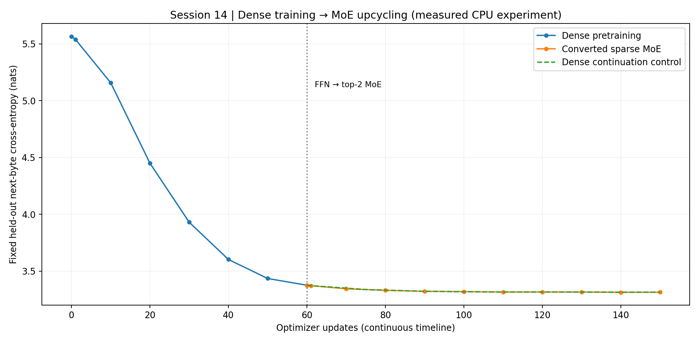
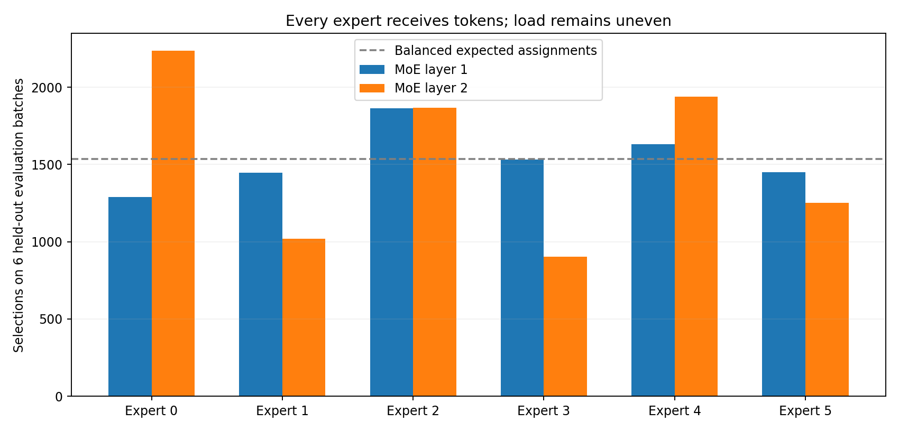

# ERA V5 — Session 14 | Dense language model → routed Mixture-of-Experts

**Status: completed, locally executed, reproducible CPU experiment.** This repository documents a small but genuine causal language model trained first with **dense feed-forward networks**, then **converted in place to sparse top-2 MoE feed-forward networks**, and trained further. It includes a matched dense-continuation control, measurements, tests, output checkpoints, and an executable Colab notebook.

> **Scope:** Session 14 asked us to train a linear/dense model, convert to MoE, and demonstrate continued training with decreasing loss. This experiment meets that narrow requirement. It does **not** claim state-of-the-art throughput, a 20M model, statistical significance, or that MoE outperforms dense models generally. The separate 20M/50M-token training target belonged to Session 13 and is not silently carried over.
>
> **Authorship:** The explanations here are a draft intended for the student's technical review. Verify that you personally understand and can reproduce the findings before presenting this README as evidence of your own understanding.

## 1. What I implemented and what I understand

I interpret “linear model” in the Session 14 lecture as the **dense Transformer feed-forward (FFN) stack**, not a scalar linear regression line. The dense FFN performs an up-projection, nonlinear activation, and down-projection; the assignment's MoE architecture replaces **that FFN**, not the attention mechanism or the output-token head.

For one token's hidden state `x` of size 64:

**Dense:** `f(x) = W_down GELU(W_up x + b_up) + b_down`, with width 128.

**Sparse MoE:** `f_MoE(x) = Σ_{i ∈ top-2(router(x))} α_i(x) f_i(x)`, where the two selected weights are softmax-normalized to sum to one. Six routed experts exist at each of two Transformer layers; each expert is a small `64 → 128 → 64` FFN. Only selected experts execute for each token.

**The central insight about upcycling:** To make a conversion without destroying already learned behavior, I cloned the learned dense FFN into all six experts, then created a new router. Initially every expert computes the same function. Because `Σ α_i(x) = 1`, the new MoE output is identical (to floating-point tolerance) to the dense FFN output, **regardless of which experts the router selects**. During training, different experts see different token selections and diverge. This is a deliberately simple function-preserving upcycling implementation, not a claim to reproduce a production sparse-upcycling scheme exactly.

**What the router does:** Each token independently produces six FP32 logits. `topk=2` picks the two highest indices. Only these two experts process that token. Their outputs are multiplied by normalized selected scores and **summed**, not concatenated. No expert is explicitly assigned “coding” or “biology”; any specialization would need empirical investigation rather than assertion.

**Balancing:** The router can over-select a few experts and starve the others. Training therefore adds a low-weight auxiliary load-balancing term. I record every expert's usage rather than assume the auxiliary term guarantees perfect balance.

## 2. Measured results

All numbers below came from completed local PyTorch CPU runs on the **300-record ERA V5 cleaned instructional sample**, with deterministic record-level train/validation splitting, seed **140926**, 257-token vocabulary (256 byte values plus one reserved token), context 48, batch 16, and AdamW at LR 0.0007. The 257th token is reserved but not emitted by the training-data builder.

| Observation | Measured result |
| --- | ---: |
| Dense model, trainable parameters | **86,592** |
| Converted MoE, *total* parameters | **253,120** |
| Converted MoE, parameters in the per-token active path | **120,512** (47.61% of MoE total) |
| Untrained dense held-out cross-entropy | **5.566130** |
| End dense phase, after 60 updates | **3.376164** |
| Immediately after FFN → MoE conversion | **3.376164** |
| End MoE phase, after 90 additional updates | **3.314345** |
| Matched dense-only control, after 90 additional updates | **3.314582** |
| MoE vs continuation-control loss difference | **−0.000237** nats/token |
| Maximum absolute difference of corresponding logits at conversion | **1.192093e-6** |
| Corpus: distinct train / val records | **245 / 55**, no overlapping exact contents detected |
| Routing | All six experts used in both MoE blocks on held-out data |
| Unit tests | **7 passed** |

The **dense phase improved**, and the **MoE phase improved further on the *same fixed held-out evaluation***. The MoE and dense-control final losses are practically indistinguishable in this small **single-seed** test; the difference is too small to claim superiority. The dense control starts from the **same trained dense checkpoint**, uses the same additional minibatch sequence, the same learning rate, an optimizer reset like the MoE arm, and the same validation windows. The MoE's auxiliary loss is optimized in addition to next-token CE but the reported comparison metric is **CE only**.

The loss plots, per-expert usage plot, and parameter accounting are in `figures/`; raw time series and checkpoints are in `artifacts/verified/`.





### Architecture and tensor shape audit

| Tensor/stage | Shape | Meaning |
| --- | --- | --- |
| `input_ids`, `targets` | `[16,48]` | batch, contiguous in-document token positions; target is one byte later |
| token embeddings | `[16,48,64]` | batch, positions, hidden features |
| pre-FFN state | `[16,48,64]` | context-mixed token features |
| router scores | `[768,6]` | batch×positions, candidate expert scores |
| selected indices/weights | `[768,2]` | batch×positions, top-2 experts and their normalized weights |
| selected expert input | `[n_e,64]` | only tokens routed to that expert |
| selected expert intermediate | `[n_e,128]` | FFN expanded features for the expert |
| selected expert output | `[n_e,64]` | expert output, accumulated via `index_add` |
| final logits | `[16,48,257]` | vocabulary score for each input token |

`n_e` changes by expert and minibatch. We train with paired windows (`X = doc[start:start+48]`, `Y = doc[start+1:start+49]`), **never crossing record boundaries**. The validation examples are fixed; training windows are generated from an independent seeded RNG.

### Routing observations

On six fixed held-out batches (each 16×48 tokens), each block makes 9,216 expert assignments (`6 × 16 × 48 × top_k=2`). The six counts were:

- MoE block 1: **1290, 1448, 1865, 1531, 1632, 1450**.
- MoE block 2: **2236, 1021, 1866, 903, 1938, 1252**.

Perfectly balanced load would be **1536** assignments per expert per block. Thus nobody is completely untrained on this evaluation, but expert utilization is uneven. Do not describe the router as perfectly balanced or the experts as domain-specialized.

### Speed and memory: don't overclaim

The MoE stores roughly **2.92×** as many parameters as the dense baseline, while the active parameter path is **1.39×** the dense parameter count. This cloned-expert demonstration is **not a computational acceleration relative to the dense baseline**; two full-width FFNs run per token plus router overhead. “Sparse” means inactive MoE experts are skipped, **not** that this particular toy MoE is faster than its much smaller dense predecessor.

The training source records an observed CPU token-throughput number for each phase (includes validation time). It is not a GPU speedup benchmark, and per-expert Python dispatch is not optimized with fused kernels or expert parallelism. Model-state and optimizer-memory growth can be derived from parameter counts, but **peak GPU memory was not measured**.

## 3. How to reproduce

**Requirements:** Python 3.10+; PyTorch 2.1+, NumPy, matplotlib, pytest. One CPU is enough for the verified configuration. Colab GPU is optional; an actual GPU is not necessary for this experiment.

```bash
python -m pip install -r requirements.txt
python -m pytest -q tests/test_experiment.py

# Dense pretraining and *function-preserving* MoE continuation.
python src/experiment.py --data data/era_v5_clean_300.jsonl \
    --dense-steps 60 --moe-steps 90 --eval-every 10 \
    --out artifacts/verified

# Independent matched continuation control, using the same saved dense checkpoint.
python src/controls.py --out artifacts/verified --coeffs --steps 90

# Regenerate graphs, metrics.csv, summary.json from the measured result files.
python build_artifacts.py
```

**Colab:** Upload `ERA_V5_S14_Dense_to_MoE.ipynb`. It reconstructs the source and the 300-record academic data sample from embedded bytes, runs tests, trains dense/MoE, runs the matched control, and plots the results, all without a repository download. The full experiment cell may run slower on the standard Colab CPU runtime. The repository includes verified CPU results, while notebook execution on a different PyTorch build/hardware may produce small numerical differences.

Saved checkpoints `dense_last.pt` and `moe_last.pt` are included. `results.json` contains the complete recorded training history. Data digest: `41f311e4db037900aac621b1850221c15d1c5431c49a0b14fdb554ca7b8b8e9c` (SHA-256).

## 4. Session 13 → 9 connections and engineering decisions

- **Session 13 (reversibility):** a technique for managing activation memory; not implemented here. MoE addresses *which FFN weights compute*, rather than reconstructing previous activations.
- **Session 12 (ZeRO):** partitioning storage of optimizer states, gradients, and parameters. No ZeRO, expert-parallel communication, or actual multi-GPU collective operations occur in this tiny experiment.
- **Session 11 (Adam/schedulers):** use AdamW, record learning rate and explicitly **reset both optimizer states at the conversion**. The dense control receives the same reset for fair comparison.
- **Session 10 (gradients):** only selected routed experts receive expert-FFN gradients from a token; the auxiliary balance term supplies router gradients. Gradient norm is clipped at 1.
- **Session 9 (loss and output head):** actual token shifts and document boundaries are checked; CE is reported independently of the router-regularization loss. Initial untrained loss is close to `ln(257)` rather than an arbitrarily enormous value.

## 5. Accuracy and limitations

1. **Small-scale/single seed:** 300 source documents; 60 + 90 updates. Not a 20M parameter or 50M token experiment. Outcomes could change with another seed, data mix, or hyperparameter.
2. **Sample and representativeness:** 100 cleaned Alpaca, 100 cleaned CodeAlpaca, and 100 cleaned Dolly records. A few hundred examples cannot demonstrate general LLM ability or specialized experts.
3. **Eval design:** fixed **document-disjoint** validation windows, no exact duplicate texts across train/val. An observed held-out improvement here is a valid limited observation, not a benchmark of downstream quality.
4. **Router auxiliary:** `N × Σ f_i P_i`, as commonly used in Switch-style router balancing, with coefficient 0.01 (averaged across MoE layers). `f_i` is fraction of selected assignments, detached from gradient; `P_i` is mean router softmax probability. This does not guarantee perfectly uniform expert usage.
5. **Sparse dispatch:** selected tokens are dispatched via per-expert indexing. Top-k indices are discrete; they are not differentiable. Gradients flow through selected gate values and selected FFNs.
6. **No capacity truncation:** every selected expert processes its full assigned subset; this is *dropless* routing, with no explicit capacity limit. Memory spikes and all-to-all traffic could become serious at production scale.
7. **Initial expert cloning:** preserves mathematical output; cloning alone can cause under-training or routing collapse later. Balance is **measured**, not asserted.
8. **Precision:** CPU FP32, deterministic seed, tied embeddings properly initialized. Maximum measured logit difference from conversion is approximately `1.19e−6`; exact bitwise identity is not expected in floating-point accumulation.
9. **Hardware:** one CPU, no physical multi-GPU, no benchmarked performance advantage over the dense model.
10. **Control:** the matched dense continuation obtained essentially the same final CE, so there is no supported quality advantage for this MoE setting.

See [`ACCURACY_AUDIT.md`](ACCURACY_AUDIT.md) for explicit evidence and transcript discrepancies.

## 6. Source and dataset provenance

**Course:** the attached **ERA V5 Session 14** transcript (2026-09-26) describes replacement of dense FFNs with routed experts, top-k scoring, weighted sums, shared vs routed experts, load balancing, and the final dense→MoE assignment. The project also uses the artifacts and implementation lessons from Sessions 13 backward to 9, **but not code from a purported unverified MoE class implementation**.

**Primary research** (used to check mechanisms, not to attribute our metrics):

- [Fedus, Zoph, Shazeer — *Switch Transformers* (2021)](https://arxiv.org/abs/2101.03961): sparse token-to-expert routing and balancing.
- [Komatsuzaki et al. — *Sparse Upcycling* (2022/2023)](https://arxiv.org/abs/2212.05055): reusing a trained dense checkpoint to initialize MoE.
- [Dai et al. — *DeepSeekMoE* (2024)](https://arxiv.org/abs/2401.06066): finer-grained and shared expert designs (not implemented here).

**Data sources** (this dataset is for *research and teaching*, not commercial deployment):

- [Stanford Alpaca](https://github.com/tatsu-lab/stanford_alpaca), upstream data **CC BY-NC 4.0 / research-only**.
- [Code Alpaca](https://github.com/sahil280114/codealpaca), check upstream `DATA_LICENSE` (noncommercial restrictions may apply; do not rely solely on third-party mirror license tags).
- [Databricks Dolly 15k](https://huggingface.co/datasets/databricks/databricks-dolly-15k), observe its data card and sharing attribution terms.

The local `data/era_v5_clean_300.jsonl` was created in the user's earlier ERA V5 Session 4 cleaning workflow; the exact 300-row educational subset is pinned by SHA-256, bundled strictly to make the experiment reproducible. **Confirm the upstream licenses and attribution requirements before publishing or redistributing**, especially the noncommercial terms. You may omit the data from a public GitHub repository and use the notebook's own academic test fixture only where licensing allows.

## 7. Human understanding / oral-defense questions

1. Why does duplicating an FFN into experts preserve the output if the top-k routing weights sum to one?
2. What is the difference between stored parameters and active parameters? Why is this MoE not necessarily faster than dense?
3. How does a top-k router obtain gradients despite discrete expert selection?
4. What stops dead experts, and why do the observed counts show imperfect balance even with an auxiliary loss?
5. Why does the experiment compare fixed held-out cross-entropy rather than random-batch training loss or a loss that includes the auxiliary router term?
6. Why is restarting AdamW at conversion not perfectly continuous training, and why must the dense comparison use an equivalent reset?

## Submission

This ZIP is **GitHub-ready**, but it is **not yet a live GitHub repository**. No repository URL is invented. To publish, create a GitHub repository, verify the data licensing notice, push these contents, and add the actual repository URL to your submission.
